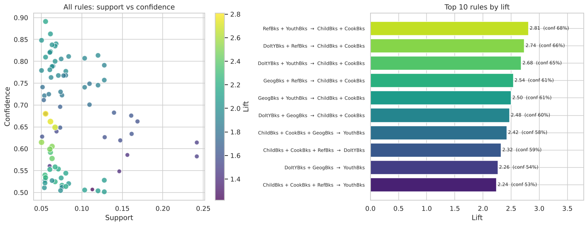
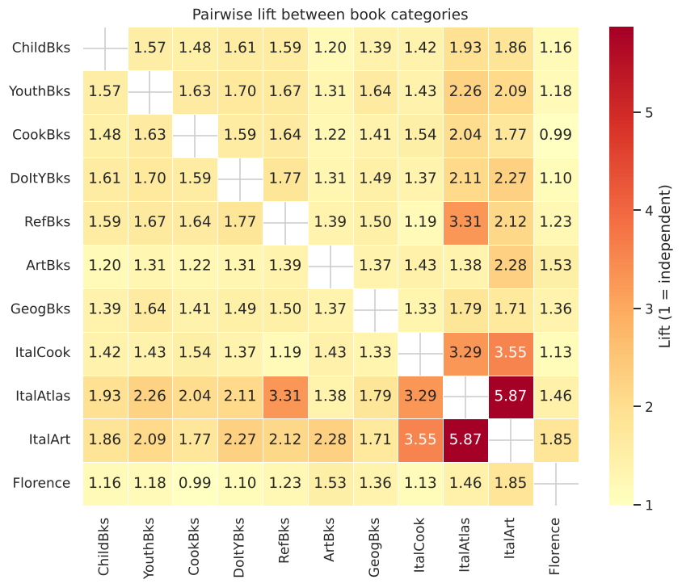

# 🛒 Market Basket Analysis: Cross-Selling for an Online Book Club

Association rule mining (Apriori) on 4,000 book-club customers to find which categories are bought together, and what a retailer should do about it.

**Stack:** Python · pandas · mlxtend · seaborn / matplotlib · Jupyter

👉 **Full analysis:** [`notebooks/association_rules_analysis.ipynb`](notebooks/association_rules_analysis.ipynb) (outputs included, renders directly on GitHub)

---

## Business question
*Which products do customers buy together, and how can those patterns drive cross-sell and campaign targeting?*

## Key findings

| # | Finding | Evidence |
|---|---|---|
| 1 | **Core general-interest cluster** (Children's, Cooking, DIY, Youth, Reference, Geography) | Youth + Reference buyers also buy Children's + Cooking **68%** of the time, **2.8×** the base rate (≈221 customers) |
| 2 | **Strong cross-sell trigger** | Children's + Youth + Reference → Cooking: **89%** confidence, lift 2.1 |
| 3 | **Hidden Italian-interest niche** | Italian Cooking / Atlas / Art show lift up to ~10, but each is bought by only ~3–11% of customers, so they are almost invisible at 5% support |
| 4 | **Florence title targeting** | Florence buyers over-index on Italian Art (1.85×) and Art books (1.53×) |
| 5 | **Caveat: heavy-buyer effect** | Nearly every category pair has lift > 1 because big buyers buy everything; lift partly reflects engagement |





## What the notebook covers
1. **Method validation** on a 10-transaction toy dataset (Faceplate) that can be checked by hand
2. **Small-sample sanity check:** why a flashy lift of 4.5 backed by 2 baskets is not a finding
3. **Data validation and EDA:** missing values, duplicates, category penetration, basket-size distribution
4. **Pairwise lift heatmap** as a pre-mining view of affinities
5. **Apriori + rule generation** (support ≥ 5%, confidence ≥ 50%) with support / confidence / lift / leverage
6. **Threshold sensitivity:** how rule counts change with `min_support` and `min_confidence`
7. **Business translation:** single-item-consequent rules turned into "offer Y to buyers of X" recommendations with customer counts
8. **Niche analysis** at 1% support (Italian titles) and Florence targeting
9. **Limitations and next steps** (correlation vs causation, binary baskets, heavy-buyer bias)

## Repository structure
```
.
├── README.md
├── requirements.txt
├── data/
│   ├── CharlesBookClub.csv
│   ├── Faceplate.csv
│   └── DATA_DICTIONARY.md
├── notebooks/
│   └── association_rules_analysis.ipynb
└── images/                # charts used in this README
```

## Run it yourself
```bash
git clone https://github.com/shahvatsal712/association-rules-book-club.git
cd <repo-name>
pip install -r requirements.txt
jupyter lab notebooks/association_rules_analysis.ipynb
```
The notebook uses relative paths (`../data`), so run it from the `notebooks/` folder or open it via Jupyter as above.

## Limitations
- Association ≠ causation: an A/B test is needed to confirm that recommendations lift sales.
- Quantities, prices and recency are discarded when baskets are binarised.
- Low-support rules (e.g. the Italian niche, ~46 customers) are hypotheses, not proven effects.

## Next steps
FP-Growth comparison · redundant-rule pruning · combining rules with RFM segments · collaborative-filtering recommender as a benchmark.

## Data and credits
Datasets and the Charles Book Club case come from *Data Mining for Business Analytics* (Shmueli, Bruce et al.); Charles Book Club adapted with permission from The Bookbinders Club (Levin & Zahavi). Faceplate data © 2016 Galit Shmueli and Peter Bruce. Used here for educational and portfolio purposes; see [`data/DATA_DICTIONARY.md`](data/DATA_DICTIONARY.md).
